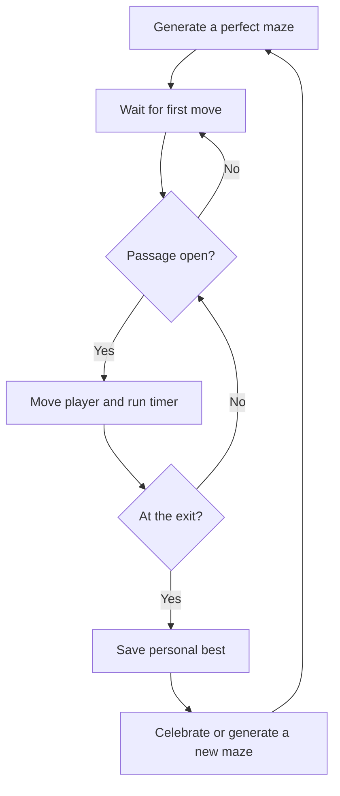

# Neon Labyrinth

A tiny neon maze for curious minds. Find the exit, beat your best time, and take another route through a freshly generated perfect maze.

**Play:** [oscarmmi.github.io/maze](https://oscarmmi.github.io/maze/)

## How to play

- Move one passage at a time with the arrow keys or **W A S D**.
- On touch screens, tap the directional pad.
- Your clock starts with your first successful move. Reach the glowing exit in the bottom-right corner to finish.
- Your fastest finish is saved in this browser. Press **R** or choose **New Maze** to generate another labyrinth.

## Run locally

```sh
npm install
npm run dev
```

Run the game-logic tests and production build:

```sh
npm test
npm run build
```

## Game loop



## Built with

Vue 3, TypeScript, Vite, and Vitest. The recursive backtracker creates a connected 15 × 15 maze with one route between every pair of cells. No backend or licensed artwork.
